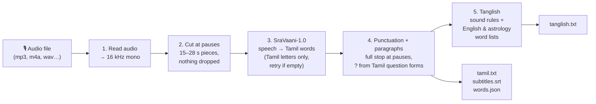

# tamil-transcribe

Turn a Tamil recording (class, meeting, voice note) into **Tamil text** and **Tanglish**
(Tamil written in English letters) — free, offline, on a normal Mac.

## Run it

```bash
./transcribe.sh "class recording.mp3"
```

That's it. Results appear in a new folder next to the file: `class recording_transcript/`

| File | What's in it |
|---|---|
| `tamil.txt` | The transcript in Tamil letters, with full stops, question marks and paragraphs; each paragraph starts with its time `[0:12:45]` |
| `tanglish.txt` | The same in Tanglish — `Naalaikku class irukku. Correct-a?` |
| `subtitles.srt` | Tamil subtitles, one sentence each — open the recording in VLC and they show up |
| `words.json` | Every word with its start time and the pause after it |

Several files at once: `./transcribe.sh class1.mp3 class2.m4a`.
Works with mp3, m4a, mp4, wav, ogg, opus, WhatsApp audio.

**First run only** (a few minutes): it installs what it needs (~1.5 GB) and downloads the
speech model (~0.9 GB). It will ask you once to log in to Hugging Face (free) — follow the
two steps it prints. After that it works offline.
**Speed:** a 78-minute class took under 3 minutes on an Apple M5 Mac (allow up to ~10 minutes per hour on older or busy machines).

## How it works



Each step is explained, with how it was tested, in [pipeline/README.md](pipeline/README.md).

## Where things are

| Folder | What's there |
|---|---|
| [`pipeline/`](pipeline/) | The transcriber itself (what `transcribe.sh` runs) and how each step works |
| [`evaluations/`](evaluations/) | Every model we compared (open models, Sarvam, Gemini), all scores, and the code to reproduce them |
| [`sravaani_eval/`](sravaani_eval/) | Deep dive on the chosen model: transcripts of the test class, comparisons with Gemini and Sarvam, tests of each pipeline step, and its weaknesses with root causes |

## How good is it?

On a real astrology class (3 test sections, 14.8 min), compared with Gemini 3.1 Pro's transcript
(not human-checked yet — % of characters that differ, lower is better):

| System | Error | Runs | Cost |
|---|--:|---|---|
| Sarvam Saaras v3 (cloud) | 16.5% | Cloud API | ₹29 per hour |
| Indic-Transcribe Core (1.2B) | 19.6% | Your Mac, ~1.5 h per hour of audio on CPU | Free |
| **This pipeline (SraVaani, 430M)** | **24.3%** | **Your Mac, a few minutes per hour** | **Free** |

On public natural-speech Tamil with human transcripts (IndicVoices), it scores **29.9% word
error** — ahead of Sarvam v3 (31.5%) and close to the best open model (28.3%).
Full results: [evaluations/README.md](evaluations/README.md).

## Known weaknesses

1. **Misses attendees' short replies** when they come right after the teacher (e.g. an
   online class). Root cause found and tested — see
   [sravaani_eval/README.md](sravaani_eval/README.md#weaknesses-and-root-causes).
2. **Misspells rare words** — astrology terms (ஜோசியம் → ஜோஷியம்) and some English words.
3. **Punctuation is rule-based** (pauses + Tamil question forms): full stops and question marks
   match Gemini's about as often as 65% / 57% (F1), where Sarvam and Gemini agree with each other
   at 74% / 77%. No commas.
4. Tanglish spelling follows common typing habits; your preferred spellings (e.g. *sani* vs
   *shani*) can be added to the word list in [`pipeline/tanglish.py`](pipeline/tanglish.py).

Planned fix for 1–2: fine-tune the model on a few hours of corrected class audio.

## Credits and licences

- Speech model: [SraVaani-1.0](https://huggingface.co/ARTPARK-IISc/SraVaani-1.0) by ARTPARK & IISc Bangalore (MIT).
- Evaluation data: IndicVoices, Kathbath (AI4Bharat, CC BY 4.0), FLEURS (Google, CC BY 4.0),
  Dakshina (Google). Audio is not included in this repo.
