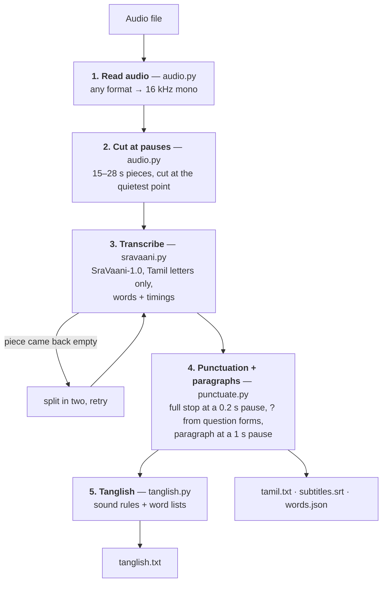

# The pipeline, step by step

| File | Step |
|---|---|
| `audio.py` | 1 Read audio, 2 Cut |
| `sravaani.py` | 3 Transcribe (model + fixes) |
| `punctuate.py` | 4 Punctuation and paragraphs |
| `transcribe.py` | Saving files, command-line entry point |
| `tanglish.py` | 5 Tanglish converter and word lists |
| `english_detect.py` | Optional automatic English-word detector (`--english-detector`) |

---

## 1. Read audio
Any audio/video file → 16 kHz mono (what the model expects). Uses PyAV, which bundles ffmpeg,
so nothing else needs installing.

## 2. Cut at pauses
The model works on pieces, not hours. We cut into **15–28 second** pieces, each cut placed at
the quietest 0.3 s inside that window, and **keep all audio**.

**Why these numbers** (tested on 30 min of long audio with known text — word error %):

| Cutting method | Pieces | WER | CER |
|---|--:|--:|--:|
| Blind 25 s cuts | 78 | 26.5 | 9.4 |
| Silero speech detector, ≤25 s | 83 | 26.9 | 9.5 |
| **Ours, 15–28 s (used)** | 98 | **27.4** | **9.7** |
| Ours, 8–25 s (first version) | 156 | 28.3 | 10.0 |
| Ours, ≤15 s | 226 | 29.1 | 10.9 |
| Silero, ≤15 s | 134 | 30.4 | 13.5 |
| Every speech turn its own piece | — | 28.9–29.8 | 10.9–11.7 |

Fewer, longer pieces win (more context, fewer edges). SraVaani itself stays accurate up to
60 s per piece; 28 s keeps pieces usable by other models (30 s limit) for comparison.
Blind cuts score well only because the test pauses were perfectly silent; on real audio they
cut words.

## 3. Transcribe — SraVaani-1.0
430M-parameter FastConformer by ARTPARK & IISc (Vaani project), MIT licence. Chosen because
it is nearly as accurate as the best open model on natural Tamil speech but **~20× faster on
CPU** (see [../evaluations/README.md](../evaluations/README.md)).

Two fixes on top of the plain model:

| Fix | Why | Effect |
|---|---|---|
| **Tamil letters only** — block non-Tamil tokens while decoding | The model has no language setting; on 9 of 287 class pieces it wrote Malayalam/Hindi/Bengali script (often the right Tamil word in the wrong alphabet) | 7 of 9 fixed (2 became empty); public sets slightly better (FLEURS 26.0→25.6, IndicVoices 30.1→29.9 WER) |
| **Retry empty pieces** — split at the quietest point and retry | A long piece occasionally comes back empty | Section A: CER 24.5→23.1 together with the new cutting |

We checked whether the model would ever write English words in English letters: its
probability for English-letter tokens at English words was ≈0, so the Tamil-only rule hides
nothing.

## 4. Punctuation and paragraphs
SraVaani outputs plain words. We add punctuation from the audio and the words:

* **Pauses come from the audio.** SraVaani's word timings have no gaps (each word "ends" where
  the next begins), so the pause after a word is measured as the longest quiet stretch before
  the next word starts.
* **Full stop** after a pause ≥ 0.2 s.
* **Question mark** instead, if the sentence ends in a Tamil question form (…ங்களா, …லாமா,
  …ுதா, tags like கரெக்டா / இல்லையா / சரியா) or has a question word near the end
  (என்ன, எப்படி, ஏன், யாரு…). Address words at the end are skipped (கரெக்டா ஐயா → judged on
  கரெக்டா), and சரிங்கய்யா ("okay sir") is not a question. A strong question tag ends a sentence
  after only a 0.1 s pause.
* **Paragraph** after a pause ≥ 1 s (or once a paragraph passes 60 s) — about 20–30 s each.
* **No commas**: even Sarvam and Gemini agree on only 10% of commas.

**Tested** against Gemini's and Sarvam's punctuation of the 3 class sections (F1, higher is better):

| Setting | Sentence ends vs Gemini / Sarvam | Question marks vs Gemini / Sarvam |
|---|--:|--:|
| *Ceiling: Sarvam vs Gemini* | *73.7* | *76.5* |
| Full stop at pause ≥ 0.45 s | 52.5 / 46.0 | — |
| Full stop at pause ≥ 0.2 s | 64.2 / 59.7 | — |
| **+ question forms + tags end sentences (used)** | **64.8 / 60.4** | **57.2 / 59.7** |

Pause thresholds tried: 0.1–1.0 s (0.2 s balances precision 64% and recall 64%). Paragraph
pause tried: 0.8–2.0 s. Code: [`../evaluations/eval_punctuation.py`](../evaluations/eval_punctuation.py).

## 5. Tanglish
Tanglish = the same Tamil words written in English letters, by sound (not translated):
வணக்கம் → *vanakkam*.

Our converter, for each word:
1. **English word written in Tamil letters?** (சார், கரெக்டா) → English spelling + Tamil ending: *sir*, *correct-a*
2. **Astrology term or place name?** (குரு, விருச்சிகம், சென்னை) → standard spelling: *guru*, *viruchiga*, *Chennai*
3. **Otherwise, Tamil sound rules** — a Tamil letter sounds different by position
   (ட between vowels → *d*, க after ங → *g*, த → *th*, ற்ற → *ttr*): பாருங்க → *paarunga*

**Tested** (% of words spelled the same way):

| Converter | 10,000 sentences romanised by people (Dakshina) | Gemini's Tanglish of the class (A / B / C) |
|---|--:|--:|
| Letter-by-letter (Aksharamukha library) | 45.5% | 45 / 39 / 45% |
| **Ours** | **64.4%** | **83 / 81 / 78%** |

The rest is mostly genuine variety (*k/g*, *zh/l*, *chandran/chandhiran*).
Your own spellings: add them to `LOANS` or `ASTRO` at the top of [`tanglish.py`](tanglish.py).

**Optional `--english-detector`** finds English words not in the list by comparing how the
word sounds with ~25,000 English pronunciations (CMU dictionary). It recovers 30/38 English
words in a test section (list alone: 23/38), but ~30% of its guesses on general Tamil text are
wrong (ஸ்டாலின் → "stealing"), so it is off by default.
